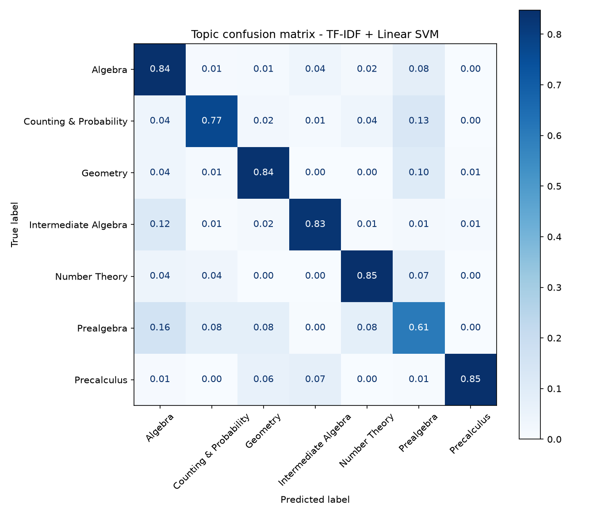

# Math Question Topic & Difficulty Classifier

Automatically tagging competition maths problems with their **topic** (7 classes) and
**difficulty level** (1–5), comparing classical TF-IDF features against sentence embeddings.

## Key findings
- **Topic classification: 0.797 macro-F1 / 79.2% accuracy** on 5,000 held-out problems
  (TF-IDF word + character n-grams with a linear SVM).
- **TF-IDF beat general-purpose sentence embeddings by 6 points** (0.797 vs 0.736 macro-F1).
  Maths problems are full of LaTeX (`\binom`, `\sin`, `\pmod`); character n-grams capture these
  signals while MiniLM, trained on ordinary English, does not.
- **Prealgebra is the hardest topic (F1 0.64)** — it overlaps with Algebra, Number Theory and
  Geometry by design. Precalculus is the easiest (F1 0.91).
- **Difficulty: 85% of predictions are within one level** of the true level (MAE 0.81 vs 1.11 for
  a constant baseline). Difficulty is much harder to read from text than topic.

## Results (held-out test set, 5,000 problems)

**Topic (7 classes)**

| Model | Accuracy | Macro-F1 |
|---|---|---|
| **TF-IDF + Linear SVM** | **0.792** | **0.797** |
| TF-IDF + Logistic Regression | 0.788 | 0.793 |
| MiniLM embeddings + Logistic Regression | 0.729 | 0.736 |

**Difficulty (levels 1–5, ordinal regression)**

| Model | MAE | Exact accuracy | Within ±1 level |
|---|---|---|---|
| **TF-IDF + Ridge** | **0.809** | **0.350** | **0.851** |
| MiniLM embeddings + Ridge | 0.866 | 0.323 | 0.824 |
| Baseline (always predict mean) | 1.111 | 0.243 | 0.734 |



## Data
[MATH dataset](https://github.com/hendrycks/math) (Hendrycks et al., 2021) — 12,500 competition
problems (7,498 train / 5,000 test, official split) across Algebra, Counting & Probability,
Geometry, Intermediate Algebra, Number Theory, Prealgebra and Precalculus.

## Project structure
```
src/01_prepare_data.py  download MATH from Hugging Face and save CSVs
src/02_train.py         topic + difficulty models, metrics and confusion matrix
figures/                plots
results/                topic_metrics.csv, difficulty_metrics.csv
```

## Run
```
pip install -r requirements.txt
python src/01_prepare_data.py
python src/02_train.py
```

## Next steps
- Fine-tune a maths-aware transformer (e.g. MathBERT) on the topic task.
- Use the solution text to improve difficulty prediction.
- Hierarchical tagging: topic → sub-topic.
